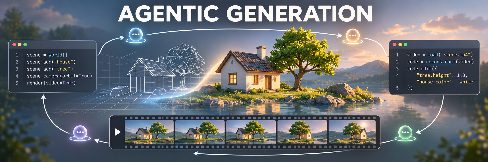

# Agentic Generation

收集 **Agentic Generation** 相关论文、项目与评测基准，关注智能体如何通过规划、编程、工具调用、执行反馈与迭代修正生成视觉内容。

覆盖方向包括 **agentic video generation、agentic 3D/world generation、code-to-video、video-to-code 和 visual coding agents**。

## 目录

| 方向 | 收录范围 |
| --- | --- |
| [Code to 3D (to Video)](#code-to-3d-to-video) | 以可执行代码构建 3D 场景或世界，可进一步渲染为视频，或用代理视频引导视频生成模型；兼收相关 visual coding harness。 |
| [Video to 3D](#video-to-3d) | 从参考视频重建可编辑的 3D 场景、动画或可执行程序，包括 video-to-code 评测。 |
| [Text to 3D (to Video)](#text-to-3d-to-video) | 从文本出发，通过资产、布局、相机、动画等工具编排生成 3D 内容，以场景构建为主要接口。 |
| [Text to Video](#text-to-video) | 智能体围绕故事、镜头和视觉参考进行规划、检查与重试，调用 DiT 等视频生成模型完成生成。 |

### 分类与阅读说明

- **先按主要生成路径分类，再按 Training-free / Training 和年份组织。** 以自由编程为核心的工作优先归入 Code to 3D；以结构化场景工具编排为核心的工作归入 Text to 3D；参考视频重建优先归入 Video to 3D。交叉工作只保留一个主条目，并在简介中说明输入与输出。
- **Training-free**：所提出的生成方法不新增模型参数训练，可使用现成的 LLM/VLM、生成模型、提示词、工具与技能更新。
- **Training**：完整方法中任一核心组件引入新增训练或微调，即归入此类。表格注明训练对象，区分 agent、视频模型和控制模块；使用预训练模型本身不算新增训练，下游具身智能体的训练也不等于环境生成器训练。
- **Benchmark** 的训练分类不适用。为保持目录结构统一，暂附在对应方向的 Training-free 表中，并显式标注；这不表示其评测的模型均无需训练。
- 年份与月份按论文首次公开时间记录；无 arXiv 条目的项目按官方技术报告时间记录。同一年内按月份倒序排列。链接指向原论文或官方项目，表中的训练划分依据公开方法。

---

# Code to 3D (to Video)

## ❄️Training-free

### 2026

| 月份 | 工作 | 类型 / 范围 | 核心内容和insight | 资源 |
| --- | --- | --- | --- | --- |
| 10 | **Code Video Model** | 方法 · Code → 3D → Video | training-free，用一个coding agent写three.js得到白模再让minimax H3渲染视频。创新点：为了解决低质量白模产生错误引导的问题，提出在H3的20步采样过程中，只在前5步用白模作为参考，后15步不用；在自己提的一个bench上测，用gpt6等模型机评，测的结构遵循（视频生成模型是否遵循了白模）、外观表现、生成质量。 | [项目 / 技术报告](https://code-video-model.github.io/) · [代码](https://github.com/code-video-model/CodeVideoModel) |
| 10 | **PROWBench: Do Video Models Render What the Program Specifies?** | Benchmark · 训练分类不适用 | 主要是测dit基于代理视频生成的视频是否符合代理视频背后的程序状态。测的指标：1️⃣规则式计算：实体的位置、范围是否符合引擎轨迹的IoU；2️⃣VLM-as-judge：动作是否在规定时间段出现、交互动作及其预期结束状态是否都实现、重现一致性、多视角一致性等；3️⃣专用模型打分：成像质量MUSIQ、美学质量等。结论：1️⃣代理视频相比相机轨迹约束效果更好；2️⃣MiniMax-H3、Seedance 2.5 无需针对这些代理额外训练，就具有较强表现；3️⃣位置正确、动作正确和画质好，是不同能力；4️⃣长视频和多视角仍然明显困难；5️⃣代理怎么设计仍是开放问题：包围盒容易留下身份—外观绑定、朝向和关节动作歧义，较具体的代理又可能被模型照搬到最终外观中 | [论文](https://arxiv.org/abs/2610.02205) |
| 09 | **MaLiang-Harness: A Programmable Path to Image and Video Generation** | Harness · 兼含 2D visual coding | 做文生图和视频，但主要是借助代码而非扩散模型（通过canvas/svg/three.js）。文生图扩散模型最多用于生成原始素材。整个流程遵循生成代码-渲染-检查闭环，一些关键设计：1️⃣记录整份作品的每个版本（包含一个全局版本号，代码、关联素材、用户prompt和当前计划）2️⃣并把每次代码修改和视觉渲染结果绑定，以便恢复历史。 | [论文](https://arxiv.org/abs/2609.34309) · [代码](https://github.com/gulucaptain/MaLiang-Harness) |
| 09 | **Recursive Code World Models: Building Complex Worlds through Recursive Scene Programs** | 方法 · Image → Code → 3D | 输入一张图片，输出3d建模code。整个构建过程是一个递归结构。在每层递归时，输入为 (state, context)，state包含(code, ref_image, camera_parameter, budget_left)。每层递归所做的事：1️⃣会选择未完成的子节点，为其构建state和context，递归调用构建函数；2️⃣收集子节点返回的新状态，用其更新当前状态，进行渲染-观察-refine。递归结束后，根节点就是想要的最终结果。 | [论文](https://arxiv.org/abs/2609.11499) · [项目](https://zhiqili-cg.github.io/RecursiveCWM) · [代码](https://github.com/ZhiqiLi-CG/RecursiveCWM_code) |
| 07 | **SimWorlds: A Multi-Agent System for Dynamic 3D Scene Creation** | 框架 · Text → Code → 3D | 没有训练，只搭了一个text-to-blender工作流。 1️⃣planner提出全局plan和每个stage的局部详细plan（一个stage是blender的一个维度，比如建模、UV、材质等）。2️⃣每个stage一个coding agent根据局部详细plan生成blender code，交给一个verifier（规则式，基于blender属性做检查：物体从属关系、穿模和接触、当前state是否和plan一致）和一个reviewer（vlm，做视觉检查，看多角度图和多帧视频）做检查。coding和检查迭代进行。 | [论文](https://arxiv.org/abs/2607.01766) · [项目](https://dynsimworlds.github.io/) |
| 05 | **SimWorld Studio: Automatic Environment Generation with Evolving Coding Agent for Embodied Agent Learning** | 框架 · Text/Image → 3D 环境 |  | [论文](https://arxiv.org/abs/2605.09423) |

## 🔥Training

### 2026

| 月份 | 工作 | 训练对象 | 核心内容和insight | 资源 |
| --- | --- | --- | --- | --- |
| 10 | **AgentGarten: Code Worlds for Evolving Agents** | 神经视频渲染器：几何条件适配、因果适配与蒸馏 | 构建供智能体交互和学习的“可编程虚拟世界”，兼顾可靠的物理规则与丰富的视觉外观。仿真器维护物体位置、碰撞和交互规则，并输出深度或法线；共享的神经渲染器据此实时生成画面，让智能体“看画面→执行动作→观察结果”。 | [论文](https://arxiv.org/abs/2610.12374) |
| 09 | **Programmable World Model** | 空间 ControlNet 与跨片段条件模块；视频主干冻结 | 给定参考图和一段话，coding agent生成程序来定义实体/关系/规则，视频生成模型接受实时计算的proxy表征（逐帧的身份/语义/运动方向表征，不是rgb白模，因此需要训一个controlNet让视频模型理解这些表示）并实时渲染。用户可以输入键鼠信息游玩，程序接受这些信息并实时更新状态。 | [论文](https://arxiv.org/abs/2609.10540) · [项目](https://alaya-lab.github.io/pwm/) |
| 08 | **Code World Model: Coding Agent as World Brain** | 视频生成器：MiniMax-H3 的 LoRA 微调 | 侧重世界建模。从两个角度建模世界：1️⃣某一事件带来的宏观的因果影响，比如对人物关系、社会结构的影响（稀疏，需要世界知识和推理）；2️⃣位置、属性、碰撞等底层变化（密集、连续、实时）。当交互或事件发生，coding  agent负责调用现有代码或更新代码来控制世界状态，代码负责更新各个状态变量，执行结果返回给coding agent形成闭环。一个视频生成模型负责将proxy video渲染成真实视频，状态不仅包含语言（只包含语言会导致控制不够精确）。proxy rep：包含相机、实体位置、姿势、轨迹、空间关系，可由coding agent编程操作。proxy video：由proxy通过一个确定性的过程转换得来，只保留粗糙建模的时空信息。 | [论文](https://arxiv.org/abs/2608.25927) |
| 07 | **VideoCoCo: Code-as-CoT for Physically-Consistent Video Generation via an Agentic Dual-Engine System** | 视频编辑器：LoRA / 全量微调；另有 Tune-Free 变体 | 一个coding agent通过code生成白膜，交给视频生成模型来生成。coding agent的实现：没有训练一个专门的 Blender coding model；而是利用现成强 coding agent（公开 skill 明确围绕 Codex 写）+ 专门设计的 agent skills/harness 来获得 prompt→Blender code 能力。 | [论文](https://arxiv.org/abs/2607.27380) · [代码](https://github.com/micky-li-hd/VideoCoCo) |

---

# Video to 3D

## ❄️Training-free

### 2026

本节收录无需新增模型训练的视频重建框架与相关评测基准；Benchmark 的训练分类不适用。

| 月份 | 工作 | 类型 / 范围 | 核心内容和insight | 资源 |
| --- | --- | --- | --- | --- |
| 11 | **MAVE: Reconstructing Editable 3D Blockouts from Film Shots** | 框架 · Video → 3D blockout | 视频→可编辑 Blender 白模。1️⃣用现成模型恢复相机、人物运动和深度，并统一到米制坐标系；2️⃣保持恢复的相机与人体姿态固定，由 agent 结合原视频和几何证据编程搭建环境，可调整人物尺度与支撑关系；3️⃣用深度冲突、几何覆盖、穿模和脚部支撑等检查反馈迭代修改。核心 insight：用专用模型的度量恢复和显式几何检查约束 agent，减少凭视觉猜测。另构建 MAVEBench（50 个镜头）和 MAVEData-3K（3,000 对白模-视频，待发布）。公开方法未新增模型训练；数据集面向后续训练。 | [论文](https://arxiv.org/abs/2611.22464) · [仓库（代码待发布）](https://github.com/yfChang-cv/MAVE) |
| 10 | **CineRecon: Benchmarking Frontier Models for Agentic Cinematic Reconstruction** | Benchmark · Video → 3D | 测现有agent用blender复刻一段视频的能力。从相机、动态、静态三个维度测，前三名：opus5.5（76.6）、gpt6-astra（63.8）、kimi k3（52.4）。评测方法：使用绑定实体与时间的检查清单，由vlm比较时间对齐的参考帧和渲染帧，从相机、静态、动态一致性三个维度、11 类指标评分。 | [论文](https://arxiv.org/abs/2610.16577) |
| 09 | **BVB: Benchmarking Agentic Video Understanding via Programmatic Reconstruction in Blender** | Benchmark · Video → Blender code | 测试模型能否通过 Blender 编程复刻一段视频。评估维度：1️⃣看一个vlm在渲染视频和原视频上都能答对的问题，占在原视频能答对的问题的比例；2️⃣看原视频和渲染视频的V-JEPA表征的相似度。两个指标都是越高越好。 | [论文](https://arxiv.org/abs/2609.15478) |

## 🔥Training

暂无条目，欢迎补充。

---

# Text to 3D (to Video)

## ❄️Training-free

### 2026

| 月份 | 工作 | 类型 / 范围 | 核心内容和insight | 资源 |
| --- | --- | --- | --- | --- |
| 04 | **StoryBlender: Inter-Shot Consistent and Editable 3D Storyboard with Spatial-temporal Dynamics** | 框架 · Text → 3D storyboard / animation | 文字->3d动画（没有视频生成模型），但给出一套比较完整的语言到blender视频的流程。1️⃣给出一段自然语言故事，一个导演director负责：建立连续记忆图（分镜大纲、全局资产表、场景和镜头上下文），然后按任务分发必要上下文给专门的agent（资产agent、布局agent、相机agent）。2️⃣为整个故事建立“可复用的标准演员和道具库”，让后续生成从反复画角色，转变为摆放、驱动和拍摄同一批 3D 实体：先检索现有资产->没有时生成->VLM负责归一化模型朝向和尺寸。3️⃣准备完资产之后，进行布局、角色运动和3d分镜的制作。这一步包含：Dimension Estimator确定真实尺寸、Spatial Planner摆放物体、Camera Operator设计构图与镜头运动，还有一系列agent负责材质、灯光等细节。这些方面都是“执行-观测-修改”闭环。补充：确定性检查的实现：llm把自然语言约束转为结构化约束（比如a面向b），然后程序按照确定性规则对agent输出的blender代码进行检查（计算a的法向量是否指向b）。 | [论文](https://arxiv.org/abs/2604.03315) |

## 🔥Training

暂无条目，欢迎补充。

---

# Text to Video

智能体编排 DiT 等视频生成模型的调用；通过可执行 3D 代理控制视频生成的工作列在 Code to 3D (to Video)。

## ❄️Training-free

### 2026

| 月份 | 工作 | 类型 / 范围 | 核心内容和insight | 资源 |
| --- | --- | --- | --- | --- |
| 09 | **StoryEngine: A State-Grounded Agentic Framework for Video Storytelling** | 框架 · 多镜头叙事 | 传统流程经常把上一段生成视频作为下一段的条件，从而导致错误传播。本文方法：状态表（记录对物体的约束。LLM先完成规划整个状态，再据此生成视频） → 选择匹配的视觉资产（人物、物体、环境的参考图）＋编写约束（LLM给出状态表的演变） → 生成起始帧 → 图生视频 → 检查与重试。 | [论文](https://arxiv.org/abs/2609.33627) |
| 06 | **GroundShot: Visually Consistent Multi-Shot Long Video Generation via Entity-Grounded Shot Scheduling** | 框架 · 跨镜头实体一致性 | 针对多镜头长视频中人物、物体和场景的外观跨镜头漂移，以及按叙事顺序生成时低质量参考导致误差累积的问题，提出无需训练、可适配不同生成模型的 GroundShot 框架：先根据预期参考质量重排镜头生成顺序，优先生成能清晰展示实体的镜头，再从生成结果中定位、提取并筛选实体级参考，建立以固定标准参考为核心、辅以一致性补充视图的视觉记忆；后续镜头检索这些参考进行条件生成，并结合质量检查与针对性重试减少错误，最后恢复叙事顺序，从而提升跨镜头视觉一致性。 | [论文](https://arxiv.org/abs/2606.20799) |

## 🔥Training

暂无条目，欢迎补充。

# 贡献

欢迎通过 Issue 或 Pull Request 补充相关工作、修正分类或更新链接。新增条目请提供：

- 工作名称、首次公开年月，以及论文或官方项目链接。
- 所属方向与 Training-free / Training 分类；涉及训练时注明具体组件。
- 一段简短说明，交代智能体的输入、输出、工具或反馈机制；评测基准请标注为 Benchmark。

优先收录明确包含智能体规划、编程、工具调用或反馈迭代机制的工作。普通视频 / 3D 生成模型仅在与上述机制直接相关时收录。
